# Laboratorio 12 - Comunicación entre Servicios

**Curso:** Desarrollo de Aplicaciones Web - TECSUP (4 - C24)
**Alumno:** José Rojas Condor

Microservicios con Spring Boot registrados en **Eureka Server** y comunicados con **OpenFeign**.

## Servicios

| Proyecto | Puerto | Base de datos | Descripción |
|---|---|---|---|
| eureka-server | 8761 | - | Servidor de registro de servicios |
| categoria-service | 8082 | bd_categoria_dev | CRUD de categorías |
| producto-service | 8083 | bd_producto_dev | CRUD de productos, pide la categoría por Feign |
| cliente-service | 8084 | bd_cliente_dev | CRUD de clientes |
| pedido-service | 8085 | bd_pedido_dev | Registro de pedidos, pide cliente y producto por Feign |

Cada servicio tiene su propia base de datos y no hay relaciones JPA entre microservicios: el producto solo guarda `categoriaId` y el pedido solo guarda `clienteId` y `productoId`. Los datos completos se obtienen llamando a la API del otro servicio con Feign, usando el nombre con el que está registrado en Eureka.

## Cómo ejecutar

1. Tener MySQL corriendo con el usuario `root` sin contraseña. Las bases se crean solas (`createDatabaseIfNotExist=true`).
2. Ejecutar primero `eureka-server` y abrir http://localhost:8761
3. Ejecutar `categoria-service`, `producto-service`, `cliente-service` y `pedido-service`.
4. Verificar en Eureka que aparezcan los 4 servicios en estado UP.

## Endpoints

**Categorías** `/api/categorias`: GET, GET /{id}, POST, PUT /{id}, DELETE /{id}

**Productos** `/api/productos`: GET, GET /{id} (incluye la categoría), POST, PUT /{id}, DELETE /{id}

**Clientes** `/api/clientes`: GET, GET /{id}, POST, PUT /{id}, DELETE /{id}

**Pedidos** `/api/pedidos`:
- `GET /api/pedidos` lista los pedidos con su cliente y producto
- `GET /api/pedidos/{id}` busca el pedido en su bd y completa cliente y producto con Feign
- `POST /api/pedidos` registra el pedido como PENDIENTE
- `PUT /api/pedidos/{id}/anular`, `/pendiente`, `/atender` cambian el estado (el pedido no se elimina)

## Validaciones

- **Pedido:** clienteId y productoId obligatorios, cantidad mayor a cero. Si el cliente o el producto no existe responde 404.
- **Cliente:** nombre, apellidos, dirección, estado y nro_dni obligatorios; el nro_dni debe tener exactamente 8 dígitos.
- **Producto:** nombre obligatorio y precio mayor a cero.

Los errores de validación responden `400 Bad Request` con el campo y el mensaje.

## Pruebas

Registrar un cliente, un producto y un pedido:

```json
POST localhost:8084/api/clientes
{ "nombre": "Carlos", "apellidos": "Ramirez", "direccion": "Av. Cascanueces 2221, Santa Anita", "estado": "ACTIVO", "nroDni": "12345678" }

POST localhost:8083/api/productos
{ "nombre": "Laptop", "precio": 2500, "stock": 10, "categoriaId": 1 }

POST localhost:8085/api/pedidos
{ "clienteId": 1, "productoId": 1, "cantidad": 2 }
```

Respuesta de `GET localhost:8085/api/pedidos/1`:

```json
{
    "id": 1,
    "clienteId": 1,
    "productoId": 1,
    "cantidad": 2,
    "estado": "PENDIENTE",
    "fecha": "2026-11-13",
    "cliente": { "id": 1, "nombre": "Carlos", "apellidos": "Ramirez" },
    "producto": { "id": 1, "nombre": "Laptop", "precio": 2500.0 }
}
```

## Capturas

| | |
|---|---|
| Servicios registrados en Eureka | 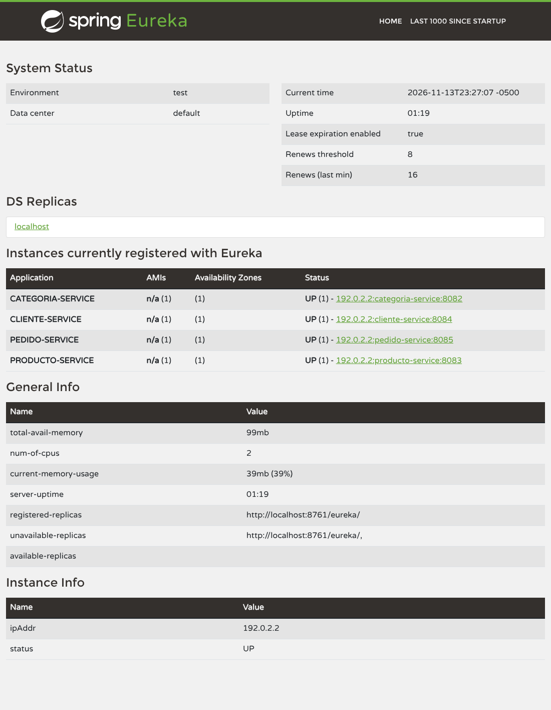 |
| POST categoría | 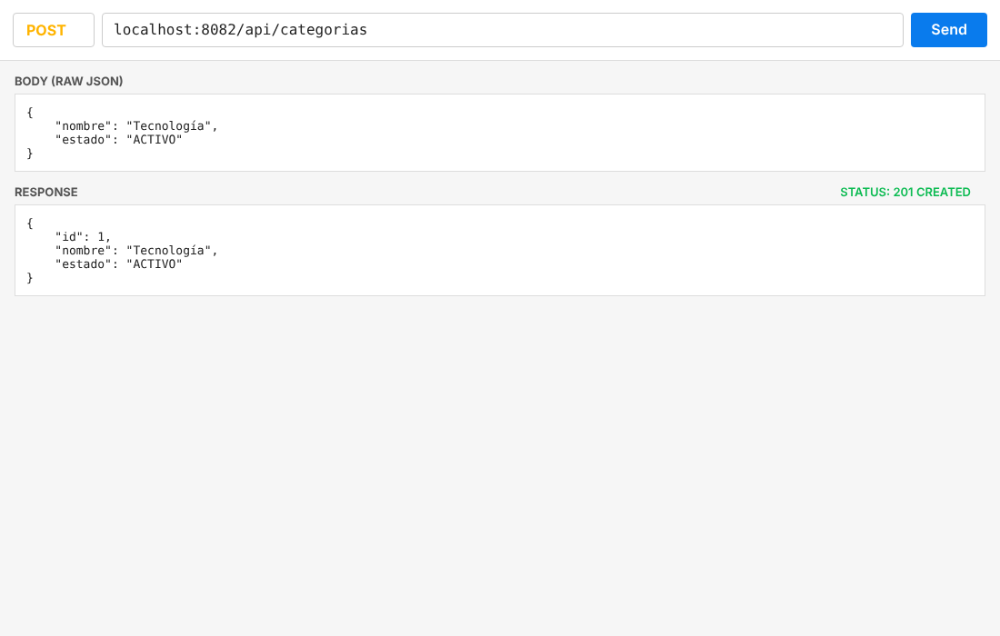 |
| GET categorías | 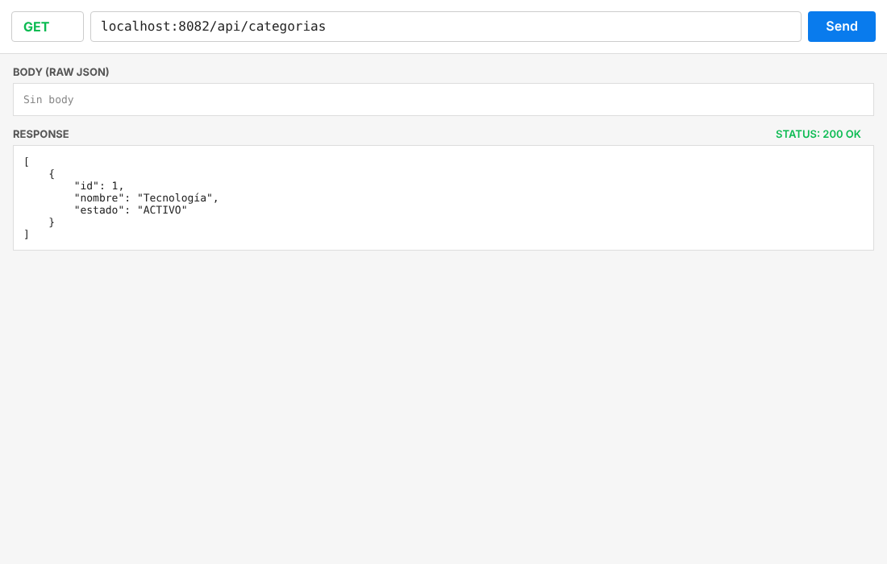 |
| POST producto | 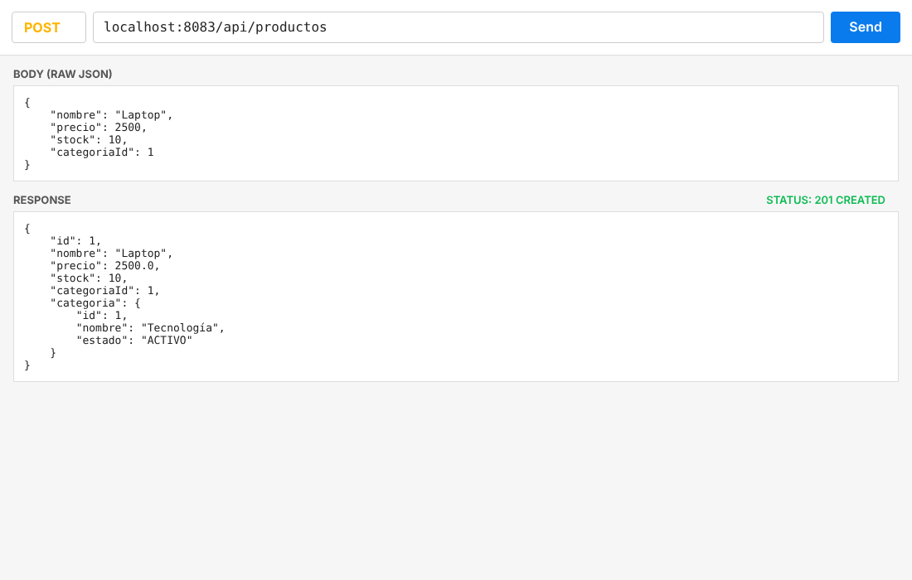 |
| GET producto con categoría (Feign) | 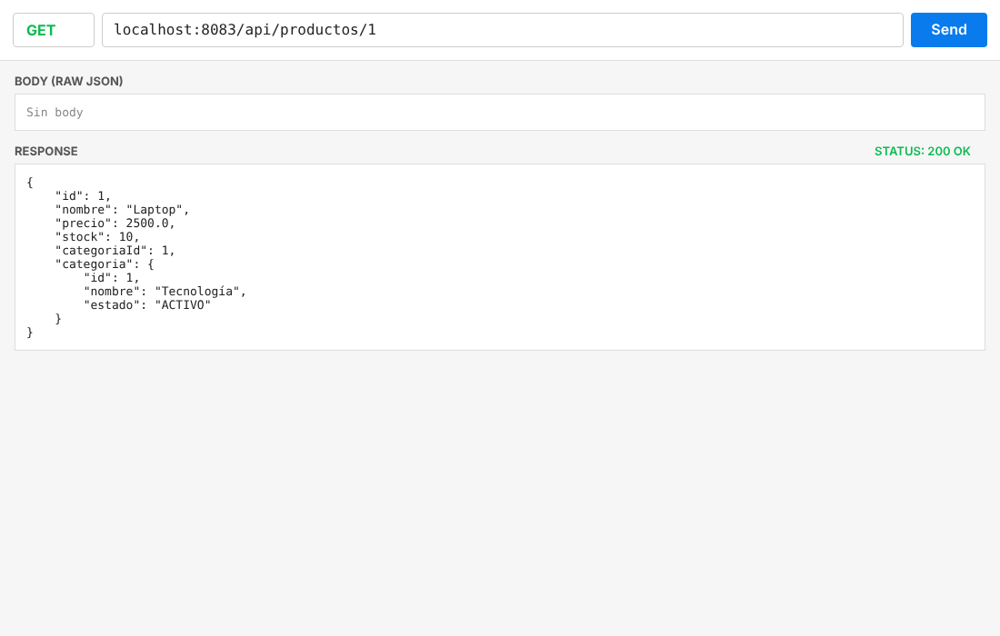 |
| Validación producto | 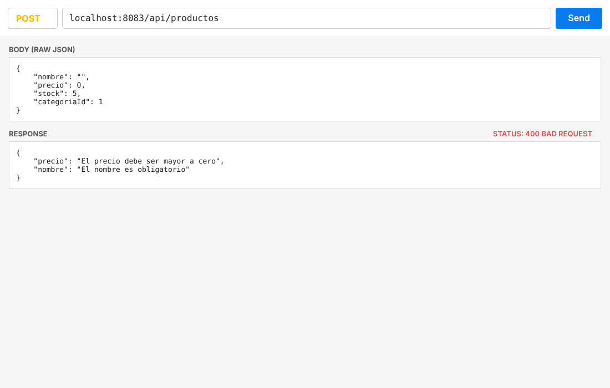 |
| POST cliente | 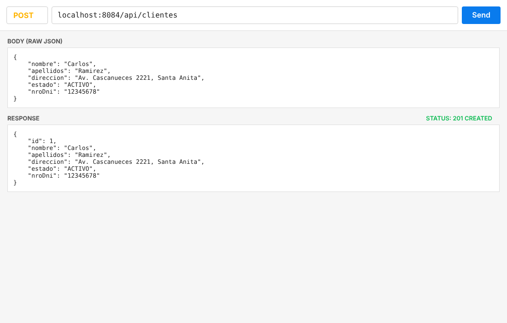 |
| GET cliente por código | 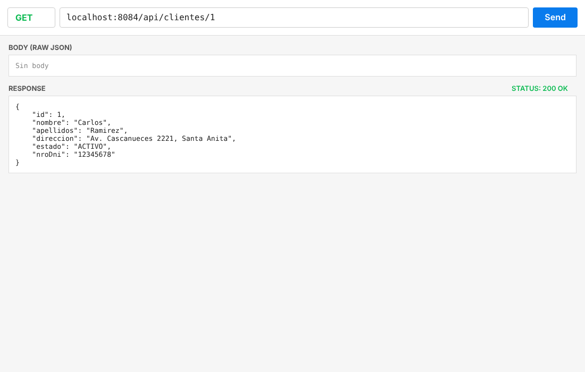 |
| Validación DNI de 8 dígitos |  |
| POST pedido | 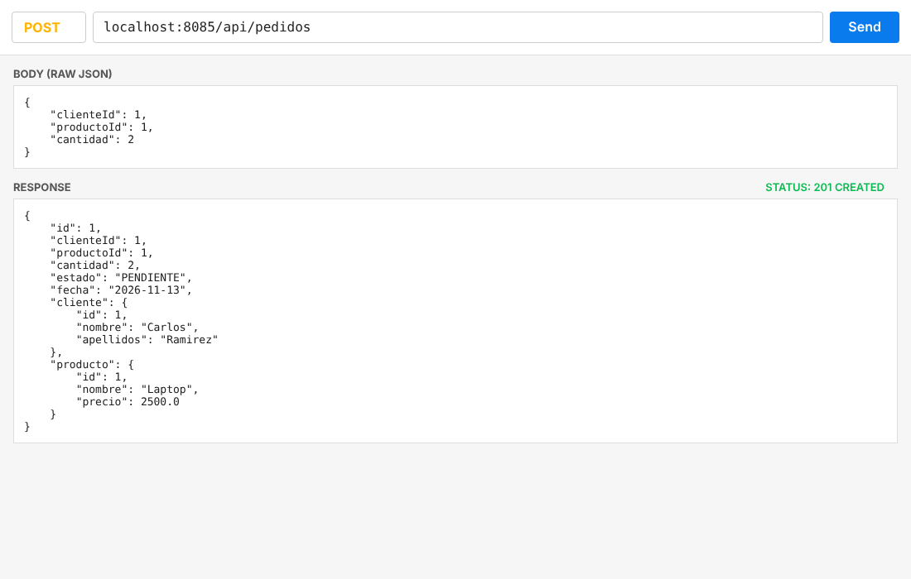 |
| GET pedido con cliente y producto |  |
| Validación pedido | 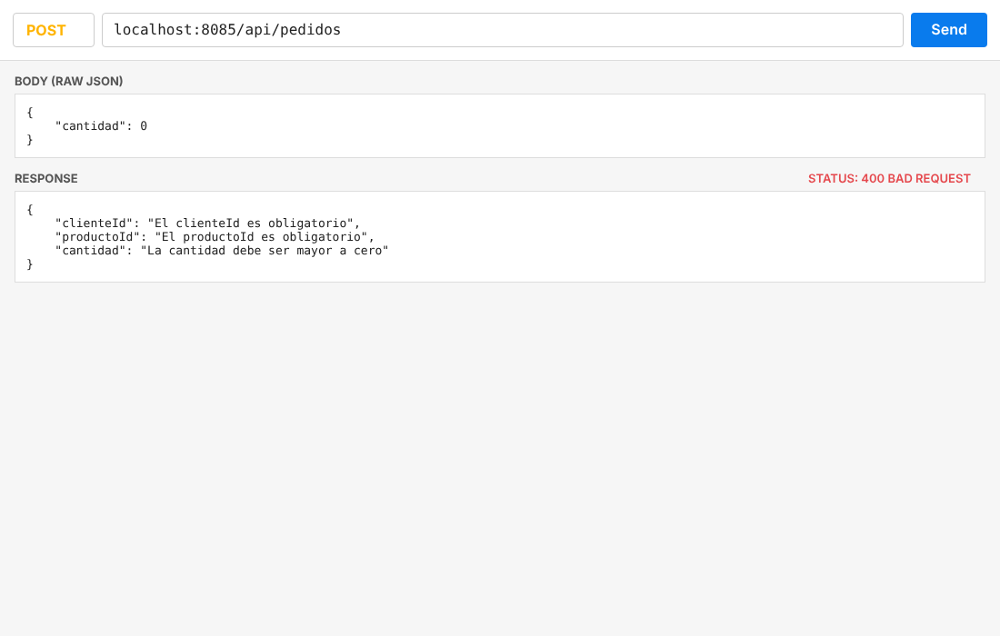 |
| Pedido con cliente que no existe | 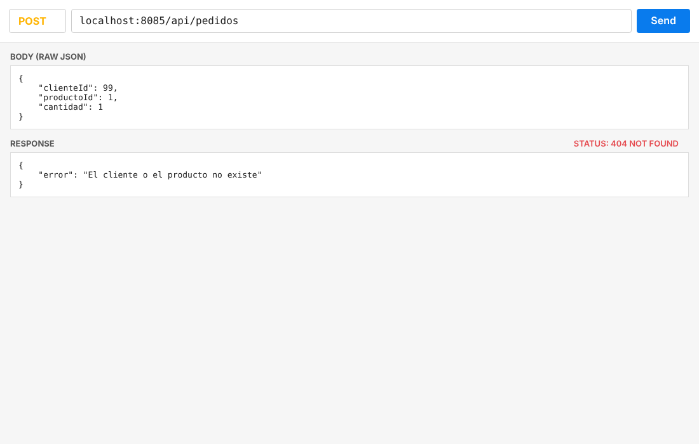 |
| Pedido atendido |  |
| Pedido anulado | 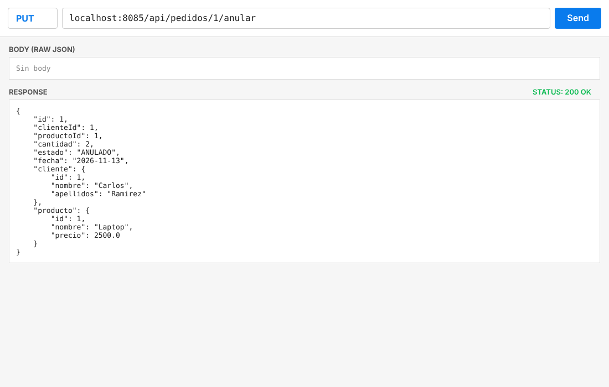 |

## Conclusiones

1. Eureka Server funciona como un directorio central donde cada microservicio se registra con su nombre, así los demás servicios lo pueden encontrar sin conocer su IP ni su puerto.
2. OpenFeign simplifica la comunicación entre servicios, porque basta con declarar una interfaz con `@FeignClient` y las rutas del otro servicio para consumir su API como si fuera un método local.
3. Guardar solo los identificadores (clienteId, productoId, categoriaId) evita duplicar información y respeta que cada microservicio sea dueño de su propia base de datos, sin relaciones JPA entre ellos.
4. Las validaciones con Bean Validation (`@NotBlank`, `@Positive`, `@Pattern`) y un manejador global de errores protegen los datos desde la entrada y le devuelven al cliente mensajes claros con el código 400.
5. Al depender de otros servicios hay que controlar los errores de comunicación: si cliente-service o producto-service no responden o el registro no existe, pedido-service debe responder con un error controlado (404 o 503) en vez de fallar. Usar estados (PENDIENTE, ATENDIDO, ANULADO) en lugar de eliminar los pedidos además mantiene el historial de compras.
